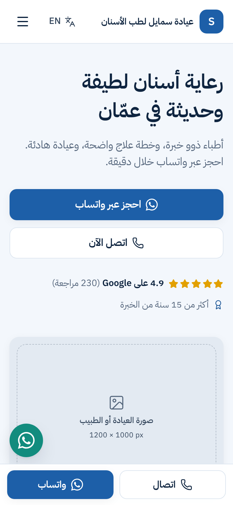
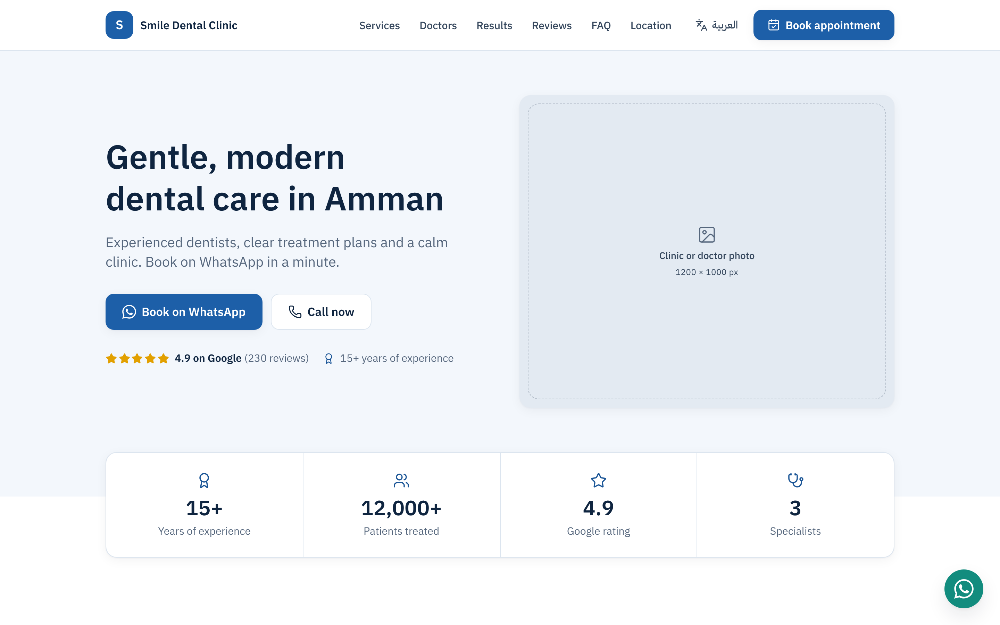

# Dental Clinic Website Template (Amman)

A calm, fast, bilingual (Arabic RTL / English) one-page website for dental clinics.
Booking goes through WhatsApp, so there is no backend. Everything clinic-specific lives in **one file: `clinic.config.ts`**.

- Next.js 16 (App Router) + TypeScript + Tailwind CSS 4, static export to `./out`
- Routes `/ar/` and `/en/`; `/` redirects to the default language from the config
- IBM Plex Sans Arabic + IBM Plex Sans, self-hosted at build time via `next/font`
- 3 colour presets, all text passing WCAG AA contrast
- Lighthouse mobile: Performance 93–99, Accessibility 100, Best Practices 100, SEO 100 (both languages, sample data)

The shipped data is **fake sample data** ("Smile Dental Clinic", "Dr. Sample Name", sample reviews clearly badged as such).

| Arabic, phone | English, desktop |
|---|---|
|  |  |

---

## Quick start

Requires Node 20.9+.

```bash
npm install
npm run dev      # http://localhost:3000 → redirects to /ar/
npm run build    # static site in ./out
npm start        # preview the built site from ./out
```

---

## Make a new clinic demo (about 45 minutes)

### 1. Copy the template (2 min)
Copy this folder into a new repository (one repo per clinic keeps deploys simple).

### 2. Edit `clinic.config.ts` (20–30 min)
Work top to bottom. Every text has `{ ar, en }`. TypeScript will underline typos and missing fields.

| Section | What to fill in | Where to get it |
|---|---|---|
| `name`, `tagline` | Clinic name and a short line | Clinic sign / Instagram bio |
| `theme` | `'clinical'`, `'fresh'` or `'premium'` | See **Theme** below |
| `defaultLanguage` | `'ar'` (most Amman clinics) or `'en'` | |
| `contact` | Phone and WhatsApp in international format, e.g. `+962 79 123 4567` | Google Maps listing / Instagram |
| `location` | Address, area, map links, coordinates, parking note | See **Google Maps links** below |
| `hours` | One line per day; `{ day: 'fri', closed: true }` for closed days | Google Maps listing |
| `rating` | Google rating, review count, link to reviews (or `null`) | Google Maps listing |
| `stats` | Years of experience, patients treated, number of specialists | Ask the clinic; keep it honest |
| `hero` | Headline and one-line subtext | Keep it short and calm |
| `services` | Toggle `showPrices`, edit/remove services, `priceFrom` per service | Ask the clinic |
| `doctors` | First doctor is featured with credentials and a personal note; others show as "Our team" | Clinic website / LinkedIn / certificates on the wall |
| `beforeAfter` | Cases, or `enabled: false` if the clinic has no consented photos | Clinic |
| `whyUs` | 4 short points | |
| `reviews` | **Real Google reviews only**, copied word-for-word in their original language | Google Maps listing |
| `abroad` | Section for patients travelling to Amman, or `enabled: false` | |
| `faq` | Prices, payment plans, insurance, pain, visits | |
| `social` | Instagram, Facebook, TikTok, YouTube URLs (empty = hidden) | |
| `seo` | Page title and description per language | |
| `credit` | Footer credit ("Website by Hyperform"), optional `url` | |

**Reviews:** each sample review has `sample: true`, which shows a visible "Sample review" badge.
Remove `sample: true` **only** from real Google reviews supplied by the clinic. Never translate or edit a real review.

**Optional sections** disappear cleanly (and section backgrounds re-alternate) when you set
`beforeAfter.enabled: false`, `abroad.enabled: false`, `rating: null`, or leave `reviews`/`faq` empty.

### 3. Photos (10 min)
Until a photo is set, the site shows a neutral labelled block with the recommended size, so a demo still looks intentional.

1. Put the clinic's originals in `photos-src/` named by their slot (`hero.jpg`, `doctor.jpg`, `team-1.jpg`, `before-1.jpg`, `after-1.jpg`, `logo.svg`…).
2. Run `npm run images`. It resizes, converts to WebP, fixes phone rotation and **removes EXIF/GPS data**. Files land in `public/images/`.
3. Point the config at them:

```ts
hero: { ..., image: { src: '/images/hero.webp', alt: { ar: 'استقبال العيادة', en: 'Clinic reception' } } },
doctors: [{ ..., photo: { src: '/images/doctor.webp', alt: { ar: 'د. …', en: 'Dr. …' } } }],
beforeAfter: { enabled: true, cases: [{ title: {...}, before: { src: '/images/before-1.webp', alt: {...} }, after: { src: '/images/after-1.webp', alt: {...} } }] },
```

| Slot | Recommended size | Shape | Notes |
|---|---|---|---|
| Hero | 1200 × 1000 px | landscape | Clinic interior or doctor with a patient (with permission) |
| Lead doctor | 1000 × 1250 px | 4:5 portrait | Plain background, natural light |
| Team | 600 × 750 px | 4:5 portrait | |
| Before / after | 1600 × 1000 px | 16:10 | Same framing and lighting for both photos of a pair. Only with written patient consent. |
| Logo | SVG preferred | | Shown at 40 px height |

Keep each photo under ~250 KB (the script usually gets far below that) to stay above 90 on Lighthouse.

### 4. Logo (2 min)
- **Text logo (default):** set `logo.monogram` (1–2 letters). The clinic name is shown next to it in the current language. The favicon and share image use the monogram too.
- **Image logo:** `logo: { image: { src: '/images/logo.svg', width: 180, height: 48 }, monogram: 'S' }`. Width/height are the file's intrinsic size; it is displayed 40 px tall.

### 5. Theme (1 min)
| Preset | Look | Good for |
|---|---|---|
| `clinical` | White + soft blue | Most general and family clinics |
| `fresh` | White + mint/teal | Younger brands, kids and orthodontics |
| `premium` | Warm off-white + soft gold/beige | Cosmetic and Hollywood-smile clinics |

To match a clinic's brand colour, add `themeOverrides`, e.g. `{ primary: '#0f6b8a', primaryHover: '#0b546d', primaryInk: '#0d5f7a' }`.
White text must stay readable on `primary` (contrast ≥ 4.5:1; check with any WCAG contrast checker).
All presets live in `src/lib/themes.ts`.

### 6. Deploy (5 min)
The build is a plain static site in `./out`.

- **Vercel:** import the repo. Framework is detected as Next.js; no settings needed. If the template sits in a subfolder of the repo, set *Root Directory* to that folder.
- **Netlify:** import the repo. `netlify.toml` already sets `npm run build` → publish `out`.
- **Anything else:** run `npm run build` and upload `out/`.

`siteUrl` can stay `''`: canonical links, hreflang, sitemap and the share image then use the Vercel/Netlify production URL automatically. Set it when the clinic gets its own domain, e.g. `siteUrl: 'https://smiledental.jo'`.

### 7. Before sending the demo
- [ ] No "Sample" text left that shouldn't be there (search the config for `Sample` and `تجريبي`)
- [ ] Phone and WhatsApp numbers open the right chat/call on your phone
- [ ] Map shows the clinic, "Get directions" opens it
- [ ] Reviews: either real (badge removed) or clearly marked samples
- [ ] Both `/ar/` and `/en/` read naturally; ask a native speaker to skim the Arabic
- [ ] Prices: confirm with the clinic or set `showPrices: false`
- [ ] Share the link in WhatsApp to yourself and check the preview card

---

## Google Maps links
- **`mapsEmbedUrl`:** Google Maps → find the clinic → **Share → Embed a map** → copy only the `src="…"` URL. The simple form `https://maps.google.com/maps?q=LAT,LNG&z=15&output=embed` also works.
- **`directionsUrl`:** Google Maps → **Share → Copy link**.
- **`geo`:** right-click the clinic pin in Google Maps; the first item is `lat, lng`.
- **`rating.reviewsUrl`:** the clinic's Google Maps link, or the "Get more reviews" link from their Google Business Profile.

---

## What's in the box

```
clinic.config.ts            ← the only file you edit per clinic
src/lib/types.ts            config types (autocomplete + error checking)
src/lib/i18n.ts             interface text in Arabic/English (buttons, labels, section titles)
src/lib/themes.ts           colour presets
src/lib/icons.tsx           icon names usable in the config → lucide icons
src/components/             one file per section
src/app/[lang]/             page + per-language metadata (title, description, hreflang, Open Graph)
src/app/og-image.png/       share image, generated at build time from the config
src/app/brand-icon.png/     favicon, generated from the monogram + theme
src/app/sitemap.ts, robots.ts
scripts/optimize-images.mjs photo optimiser (npm run images)
```

**Page order:** sticky header → hero → trust bar → services → doctor(s) → before & after → why us → reviews → patients from abroad → FAQ → location → booking form → footer. Phones also get a fixed Call / WhatsApp bar and a floating WhatsApp button.

**Booking:** every WhatsApp link uses `wa.me` with a prefilled message in the visitor's language. Each service card pre-fills that service. The form validates name and phone (Arabic-Indic digits are accepted and converted), then opens WhatsApp with a formatted request:

```
مرحباً عيادة سمايل لطب الأسنان، أودّ حجز موعد.

الاسم: …
رقم الهاتف: 0791234567
الخدمة: الفينير وابتسامة هوليوود
اليوم المفضّل: الأحد
الوقت المفضّل: مساءً
```

**SEO:** per-language title/description, canonical + hreflang (`ar`, `en`, `x-default`), Open Graph and Twitter cards, `sitemap.xml`, `robots.txt`, and JSON-LD for `Dentist` (address, geo, opening hours, phone, rating) plus `FAQPage`.

**Share image:** `/og-image.png` is drawn from the config (English name, area, rating, phone). It uses English text because the image renderer cannot shape Arabic letters correctly. To use a designed image instead, delete `src/app/og-image.png/` and put a 1200 × 630 `og-image.png` in `public/`.

**Interface text** (button labels, section titles, form messages) is in `src/lib/i18n.ts`. It is the same for every clinic, so you normally leave it alone.

## Design rules this template follows
- **Motion:** one-time fade + 16 px rise as sections enter (450 ms ease-out), gentle hover lift, smooth FAQ and before/after slider. No parallax, preloaders, carousels, popups, autoplay or custom cursors. `prefers-reduced-motion` turns all animation off.
- **RTL:** only logical CSS (`ms-`/`me-`, `ps-`/`pe-`, `start`/`end`, `text-start`). Phone numbers stay left-to-right inside Arabic text. "Before" is always on the reading-start side of the slider.
- **Content:** warm, short sentences; no "100% painless" or "guaranteed results". Prices are "starting from" with a note that the final price follows an examination. Before/after photos carry "Shared with patient consent."
- **Speed:** below-the-fold sections use `content-visibility: auto` (switched off automatically when a link opens at a `#section`, so it lands exactly). The map iframe is lazy-loaded.
